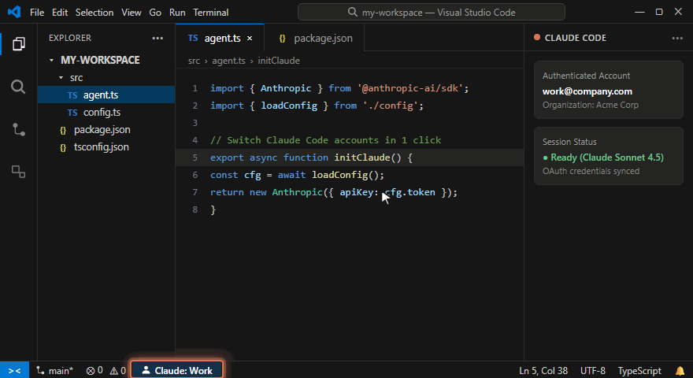
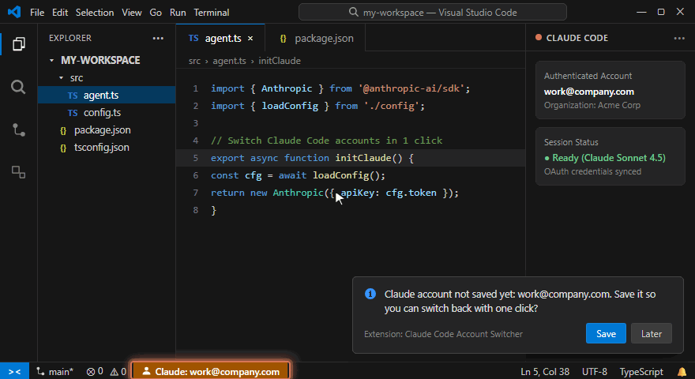

# Claude Code Account Switcher

**Switch between multiple Claude Code accounts (Work, Personal, Client) with one click from the VS Code status bar.**

*Built specifically for Windows (and Linux). No symlinks, no WSL required, and 100% encrypted credential storage.*

[English](#features) • [Italiano](#italiano) • [Step-by-Step Setup Guide](docs/SETUP_GUIDE.md)

> [!NOTE]  
> **Unofficial extension** — not affiliated with or endorsed by Anthropic. "Claude" and "Claude Code" are trademarks of Anthropic, PBC.

---

## ⚡ Visual Walkthrough

### 1. Instant One-Click Switching
Click your active profile on the status bar or press `Ctrl+Alt+A`, select any saved profile, and VS Code reloads ready to work.

  

### 2. Effortless First-Time Setup & Account Detection
The extension detects new Claude Code authentications automatically and prompts you to assign a friendly name.

  

---

## 🚀 Features

- **Status Bar Integration:** Shows the currently active account name in the bottom-left status bar. Click anytime to switch.
- **Convenient Shortcut:** Press **`Ctrl+Alt+A`** (or use `Claude: Switch Account` in the Command Palette) for quick access.
- **Auto-Detection of New Logins:** Whenever you log in with a new account in the Claude Code panel, the extension immediately detects it and prompts you to save it.
- **Token Refresh Protection:** Automatically syncs and updates OAuth access tokens right before switching, preventing session expiration and stale credentials.
- **OS-Level Encrypted Storage:** Snapshots are safely stored in VS Code's `SecretStorage` (Windows DPAPI / Credential Manager), never in unencrypted plaintext files.
- **Automatic Backup:** Creates an isolated timestamped backup of your credentials in `%USERPROFILE%\.claude-code-account-switcher-backup\` before the first modification of each session.
- **Conflict Prevention:** Detects and alerts if legacy `CLAUDE_CONFIG_DIR` environment variables are conflicting with the session directory.
- **13 Languages Supported:** Automatically matches your VS Code display language — English, Italiano, Español, Français, Deutsch, Português (Brasil), 日本語, 简体中文, 繁體中文, 한국어, Русский, Polski, Türkçe.

---

## 📖 Quick Setup (Step-by-Step)

For an in-depth walkthrough with tips and troubleshooting, see the [Full Setup Guide](docs/SETUP_GUIDE.md).

1. **Log in to your first account** in the official Claude Code panel.
2. A prompt appears: *"Claude account not saved yet... Save"* → click **Save** and assign a label (e.g. `Work`).
3. Click the status bar item `Claude: Work` (or press `Ctrl+Alt+A`) and choose **`Add new account…`**.
4. Confirm the prompt to log out of the active session.
5. In the Claude Code panel, complete the browser login for your second account.
6. When prompted, enter a name (e.g. `Personal`).
7. **Done!** From now on, simply click the status bar item or press `Ctrl+Alt+A` to swap accounts anytime.

---

## ⚙️ Configuration

| Setting | Default | Description |
|---|---|---|
| `claudeCodeAccountSwitcher.autoReload` | `true` | Automatically reloads the VS Code window after changing accounts so Claude Code immediately binds to the new credentials. |
| `claudeCodeAccountSwitcher.claudeConfigDir` | `""` | Custom Claude Code directory path. Leave empty to use default `%USERPROFILE%\.claude` (or system `CLAUDE_CONFIG_DIR`). |

---

## ⚠️ Requirements & Limitations

- **Platform Support:** Windows 10/11 and Linux.
- **macOS Notice:** macOS is currently not supported because the Anthropic CLI uses the macOS Keychain directly instead of file-based credential storage.
- **Active Terminals:** Background CLI processes already running `claude` in an integrated terminal retain their original session. Restart the terminal tab when switching.

---

## 🇮🇹 Italiano

**Claude Code Account Switcher** ti permette di alternare tra più account Claude Code (es. Lavoro e Personale) con un solo clic dalla barra di stato di VS Code.

Progettato per **Windows** (e Linux): evita problemi con i collegamenti simbolici (symlink) e non richiede WSL.

### Come iniziare

1. Effettua l'accesso con il tuo account principale nel pannello di Claude Code.
2. Apparirà la notifica: *"Account Claude non ancora salvato... Salva"* → clicca **Salva** e assegna un nome (es. `Lavoro`).
3. Clicca su `Claude: Lavoro` nella barra di stato in basso a sinistra (oppure premi `Ctrl+Alt+A`) e seleziona **`Aggiungi nuovo account…`**.
4. Conferma la disconnessione temporanea della sessione attiva.
5. Nel pannello di Claude Code, esegui l'accesso nel browser con il tuo secondo account.
6. L'estensione rileverà automaticamente il nuovo accesso e ti chiederà un nome (es. `Personale`).
7. **Pronto!** Da questo momento in poi basta un clic sulla barra di stato per passare da un account all'altro.

Per la guida completa in inglese consulta la [Setup Guide](docs/SETUP_GUIDE.md).

---

## 📄 License

Distributed under the [MIT License](LICENSE).
