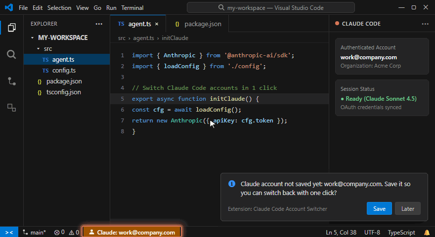
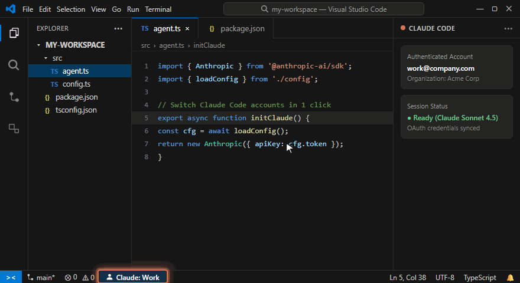

# Step-by-Step Setup Guide

This guide walks you through setting up and using **Easy Account Switcher for Claude Code** to seamlessly manage multiple Claude Code accounts (e.g., Work and Personal) in Visual Studio Code on Windows.

---

## Prerequisites

1. **Visual Studio Code** (version `1.90.0` or higher).
2. The official **Claude Code** extension installed and logged in with at least one active Anthropic account.
3. Windows 10/11 or Linux (macOS stores credentials in the OS Keychain and is not currently supported).

---

## Step 1: Install the Extension

### Option A: From VS Code Marketplace (Recommended once live)
1. Open Visual Studio Code.
2. Press `Ctrl+Shift+X` to open the Extensions view.
3. Search for **`Easy Account Switcher for Claude Code`** (Publisher: `aresdesign`).
4. Click **Install**.

### Option B: From `.vsix` Package
1. Download `easy-account-switcher-for-claude-code-0.1.0.vsix`.
2. Press `Ctrl+Shift+P` (or `F1`) to open the Command Palette.
3. Type and select **`Extensions: Install from VSIX...`**.
4. Select the `.vsix` file to install it.

---

## Step 2: Save Your First Account (e.g. "Work")



1. Make sure you are currently authenticated in Claude Code with your primary account.
2. When the extension activates, it inspects your existing Claude Code credentials:
   - If an unsaved account is detected, a notification appears at the bottom-right:  
     > *"Claude account not saved yet: you@company.com. Save it so you can switch back with one click?"*
   - Click **Save**.
3. An input box will prompt:
   > *"Name for account you@company.com"*
4. Type a descriptive label (for example, `Work` or `Company`) and press `Enter`.
5. Your status bar (bottom-left) will now display:
   ```
   [icon] Claude: Work
   ```

---

## Step 3: Add Your Second Account (e.g. "Personal")

1. Click on the status bar item **`Claude: Work`** in the bottom-left corner (or press `Ctrl+Alt+A`).
2. In the menu that pops up, select **`Add new account…`**.
3. A confirmation dialog will explain:
   > *"Claude Code will be logged out (the current account stays saved). Then log in with the new account from the Claude Code panel."*
4. Click **Continue**.
5. VS Code will cleanly log out the active Claude Code session and reload the window.
6. Now open the **Claude Code** panel (or run `/login` in your terminal).
7. Authenticate via your browser with your second Anthropic account (e.g. personal email).
8. Once completed, the extension immediately detects the new login and displays:
   > *"New Claude login detected: personal@email.com. What do you want to call this account?"*
9. Type a name (e.g., `Personal`) and hit `Enter`.
10. The status bar will now display:
    ```
    [icon] Claude: Personal
    ```

---

## Step 4: Switching Between Accounts with One Click



Whenever you want to switch context:

1. **Click the Status Bar item** on the bottom-left:
   - Or press **`Ctrl+Alt+A`**
   - Or open the Command Palette (`Ctrl+Shift+P`) and type `Claude: Switch Account`.
2. A quick-pick menu appears listing all your saved accounts:
   - `✓ Work (you@company.com) - Active`
   - `  Personal (personal@email.com)`
3. Select the target profile (e.g., `Personal`).
4. The extension:
   - Automatically synchronizes and saves any refreshed tokens from your current session.
   - Restores the target account's credentials.
   - Automatically reloads the VS Code window (`workbench.action.reloadWindow`).
5. Claude Code immediately resumes with the selected account!

---

## Step 5: Managing Accounts (Rename / Remove)

From the quick-pick menu (`Ctrl+Alt+A`), you can also:
- **Rename account…**: Change the display name shown in the status bar.
- **Remove saved account…**: Delete an account snapshot from secure storage (note: this will not log you out if it is currently active).

---

## Security & Backup Architecture

- **Encrypted Storage:** Account snapshots are stored inside VS Code's native `SecretStorage` service, backed by the operating system's cryptographic credential store (Windows DPAPI / Credential Manager).
- **Automatic Session Backup:** Before making the first filesystem modification in any VS Code session, an automatic timestamped backup of `.credentials.json` and `.claude.json` is preserved in:
  ```
  %USERPROFILE%\.easy-account-switcher-for-claude-code-backup\
  ```
- **Zero Symlinks:** Avoids Windows filesystem symlink privilege barriers and compatibility issues.

---

## Troubleshooting & Tips

### Terminal sessions
Terminal sessions running interactive CLI commands (`claude`) do not automatically pick up credential swaps from the parent process. If you have a terminal open, either run `exit` and open a fresh terminal tab, or launch a new task.

### Multiple VS Code Windows
If you have multiple VS Code editor windows open when switching profiles, reload the other windows (`Ctrl+Shift+P` -> `Developer: Reload Window`) to ensure all windows share the active credentials.

### Claude Config Directory Overrides
If you previously used a script or tool that configured `CLAUDE_CONFIG_DIR` in `claudeCode.environmentVariables`, the extension will prompt you to safely remove it so that credentials map consistently.

